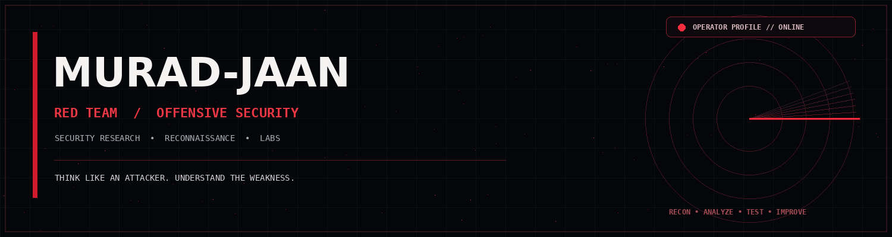
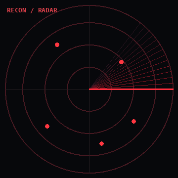
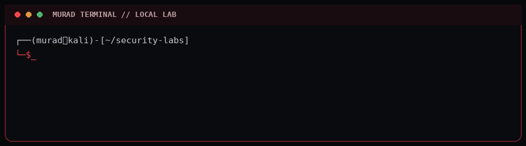

<div align="center">



[](#)
[](#)
[](#)

**THINK LIKE AN ATTACKER. UNDERSTAND THE WEAKNESS. STRENGTHEN THE DEFENSE.**

</div>

---

## `01 / OPERATOR PROFILE`



```bash
┌──(murad㉿kali)-[~]
└─$ whoami

Murad Jan
Computer Science Student
Offensive Security Learner
Red Team & Security Research
```

I study systems from an attacker's perspective to understand weaknesses, assess security controls, and help build stronger defenses. My approach is hands-on: learn the fundamentals, test in authorized labs, document findings, and keep improving.

<br clear="right"/>

## `02 / MISSION OBJECTIVES`

| DOMAIN | CURRENT FOCUS |
|:--|:--|
| 🔴 Red Team | Methodology, attack simulation, lab practice |
| 🌐 Web Security | HTTP, authentication, application testing |
| 🛰️ Network Security | Reconnaissance, DNS, network analysis |
| 🐧 Linux Security | Linux administration and command-line skills |
| 🪟 Windows Security | Windows fundamentals and Active Directory |
| ⚙️ Automation | Python, Bash and PowerShell |

## `03 / TECHNICAL ARSENAL`

**Systems**  
`Kali Linux` `Fedora` `Ubuntu` `Windows`

**Scripting & Development**  
`Python` `Bash` `PowerShell` `JavaScript` `HTML` `Dart`

**Web & Backend**  
`Flask` `Node.js` `JWT` `Nginx` `Apache`

**Data & Platforms**  
`PostgreSQL` `MySQL` `MongoDB` `Redis` `SQLite` `AWS` `Cloudflare`

**Workflow**  
`Git` `GitHub` `GitLab` `Postman`

## `04 / ACTIVE OPERATIONS`

### 🔴 AI GUARD — IN DEVELOPMENT
An AI-assisted cybersecurity project exploring security analysis and threat classification.

`AI` `Python` `Cybersecurity`

### 🔴 CYBERSECURITY LABS — ONGOING
Hands-on learning through controlled Linux, networking, Windows, and web security environments.

`Kali Linux` `Networking` `Web Security`

### 🔴 SECURITY RESEARCH — ONGOING
Studying vulnerabilities, authentication, security mechanisms, and responsible testing techniques.

`Reconnaissance` `Research` `Application Security`

## `05 / LIVE TERMINAL`

<div align="center">

</div>

## `06 / TRAINING STATUS`

```text
[ ACTIVE ]  Web Application Security
[ ACTIVE ]  Network Reconnaissance
[ ACTIVE ]  Linux & Windows Fundamentals
[ ACTIVE ]  Red Team Methodologies
[ ACTIVE ]  Python & Bash Automation
[ BUILDING ] Practical Security Research
```

## `07 / GITHUB TELEMETRY`

<div align="center">


</div>

> External stats services can occasionally be unavailable. The rest of this profile and its local animations do not depend on them.

## `08 / CONNECT`

<div align="center">

[](https://www.linkedin.com/in/murad-jan)
[](mailto:muradjan.work@gmail.com)

<br>

```text
LEARN  /  TEST  /  ANALYZE  /  IMPROVE
AUTHORIZED TESTING ONLY.
```

</div>
