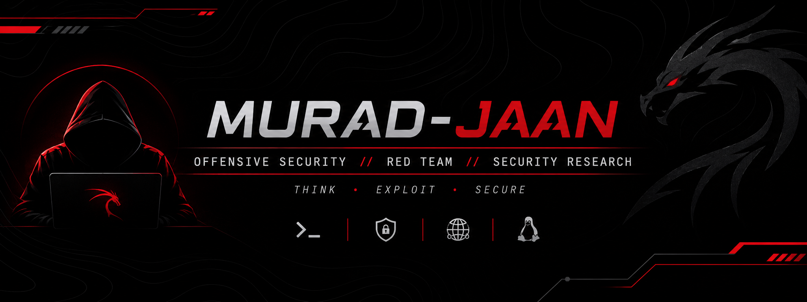

 <div align="center">



# MURAD JAN

### OFFENSIVE SECURITY | RED TEAM | SECURITY RESEARCH

*Think like an attacker. Understand the weakness. Strengthen the defense.*

[](https://www.linkedin.com/in/murad-jan)
[](mailto:muradjan.work@gmail.com)

</div>

---

## `01 // WHOAMI`

Hey, I'm **Murad Jan**, a Computer Science student passionate about Offensive Security, Red Team Operations, and Cybersecurity Research.

I'm interested in understanding how systems work, discovering security weaknesses, and learning how vulnerabilities can be identified, analyzed, and prevented.

I believe in practical learning, continuous research, and building real technical skills through hands-on security labs.

**My mission:** Develop into a skilled Offensive Security Engineer and contribute to making digital systems more secure.

## `02 // CURRENT FOCUS`

- 🔴 Ethical Hacking & Red Team Methodologies
- 🌐 Web Application Security
- 🌍 Network Security & Reconnaissance
- 🐧 Linux & Windows Security
- 🔍 Vulnerability Assessment
- 💻 Python & Bash Automation
- 🛡️ Security Research

## `03 // TECHNICAL SKILLS`

**Operating Systems & Environments**


**Programming & Scripting**


**Development & Version Control**


## `04 // SECURITY INTERESTS`

| Area | Focus |
|---|---|
| Reconnaissance | DNS, IPs, ports and enumeration |
| Web Security | HTTP, authentication and access control |
| Network Security | TCP/IP and network protocols |
| Linux Security | Permissions, processes and services |
| Windows Security | System security and Active Directory |
| Vulnerability Research | Identification and analysis |

## `05 // PROJECTS & RESEARCH`

### AI Guard
AI-powered cybersecurity project exploring intelligent security analysis and threat classification.

### Red Team Labs
A growing collection of hands-on exercises, technical notes, and authorized security experiments.

### Security Research
Documenting vulnerabilities, security concepts, technical findings, and remediation approaches.

[Explore my repositories →](https://github.com/Murad-Jaan?tab=repositories)

## `06 // GITHUB STATISTICS`

<div align="center">


</div>

## `07 // CONTRIBUTION ACTIVITY`

<div align="center">


</div>

## `08 // MINDSET`

```bash
$ whoami
Murad-Jan

$ objective
Become an Offensive Security Engineer

$ methodology
Learn → Practice → Analyze → Document

$ ethics
Authorized Testing Only

$ status
Always Learning...
```

## `09 // CONNECT`

<div align="center">

[](https://www.linkedin.com/in/murad-jan)

[](mailto:muradjan.work@gmail.com)


**OFFENSIVE SECURITY • RESEARCH • CONTINUOUS LEARNING**

</div>
